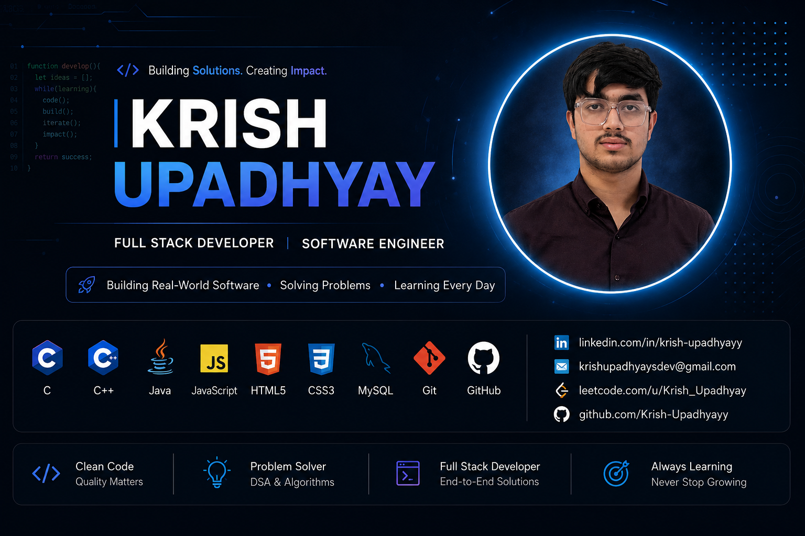

<!-- HERO BANNER -->

<!-- TYPING HEADER -->
<h1>
  
</h1>

  <b>Computer Science Student (2025–2029)</b> • <b>Open Source Contributor</b> • <b>Tech Explorer</b>

<!-- QUICK PROFILE BADGES -->

  
  
  

---

## 📌 Executive Summary & Quick Bio

> *"Code is not just syntax; it's a medium for solving real-world challenges through continuous iteration, elegant design, and robust logic."*

I am a dedicated **Computer Science Undergraduate (B.Tech 2025–2029)** passionate about designing scalable full-stack web applications, mastering **Data Structures & Algorithms (DSA)**, and crafting intuitive user experiences. My development journey centers around modern web tech, API integrations, clean architecture, and continuous technical growth.

<table align="center" width="100%">
  <tr>
    <td width="50%" valign="top">
      <h3>🚀 Quick Facts</h3>
      <ul>
        <li>🎓 <b>Degree:</b> B.Tech in Computer Science (2025 – 2029)</li>
        <li>💻 <b>Current Focus:</b> Full-Stack & Enterprise Systems (Java, Next.js, Python, REST APIs)</li>
        <li>🧠 <b>Algorithmic Practice:</b> Active problem solver on LeetCode & HackerRank</li>
        <li>🎯 <b>Career Goal:</b> Software Engineering Internship / Full-Stack Developer Roles</li>
        <li>⚡ <b>Superpower:</b> Fast learner bridging robust backend architecture with intuitive UI</li>
      </ul>
    </td>
    <td width="50%" valign="top">
      <h3>🌱 Learning & Exploration</h3>
      <ul>
        <li>⚛️ <b>Modern Frontend:</b> Next.js 16 (App Router), React 19, TypeScript, Tailwind CSS</li>
        <li>🛠️ <b>Enterprise & Backend:</b> Jakarta EE, Hibernate ORM, FastAPI, Node.js & Express</li>
        <li>🗄️ <b>Databases:</b> MySQL, MongoDB, SQLite & Relational Data Modeling</li>
        <li>🏆 <b>Hackathons:</b> Smart India Hackathon (SIH) & RIFT Hackathon Participant</li>
        <li>🤝 <b>Collaboration:</b> Open to technical discussions, internships & open-source projects</li>
      </ul>
    </td>
  </tr>
</table>

---

## 🛠️ Tech Stack & Capabilities

### 💻 Programming Languages

  
  
  
  
  
  

### 🎨 Frontend & UI Frameworks

  
  
  
  
  
  

### 🗄️ Backend, Databases & Enterprise

  
  
  
  
  
  
  

### 🛠️ AI, Cloud & Developer Tools

  
  
  
  
  
  
  
  

---

## 🌟 Featured Engineering Projects

<table width="100%">
  <tr>
    <td width="50%" valign="top">
      <h3>📚 Enterprise Library Management System</h3>
      
A full-stack, enterprise-grade automated library system built with Java 17, Jakarta Servlets, and Hibernate ORM running on Apache Tomcat. Engineered with complete role-based workflows for Admins and Members, real-time inventory counters, and automated overdue fine calculation.

      
<b>Key Features:</b> RBAC authentication, book catalogue with dynamic stock decrement/increment, member record tracking, automated loan/return lifecycle & overdue penalty engine.

      

        
      

      

        <a href="https://github.com/Krish-Upadhyayy/Library-management-system"><b>📂 GitHub Repository</b></a> • 
        <a href="https://library-management-system-g6kt.onrender.com"><b>🚀 Live Demo</b></a>
      

    </td>
    <td width="50%" valign="top">
      <h3>👁️ Stithi AI — CCTV Compliance & Headcount Audit</h3>
      
An intelligent computer vision compliance auditing system developed for the <b>Smart India Hackathon (SIH)</b> and vocational training schemes (PMKVY/NSDC). Automates classroom attendance verification and infrastructure discrepancy auditing via edge AI with zero facial biometrics.

      
<b>Key Features:</b> YOLOv8 anonymous trainee presence estimation, DPDP Act 2023 privacy-by-design, low-bandwidth snapshot pipeline, statutory 7-day automated purge daemon & 166 automated test suites.

      

        
      

      

        <a href="https://github.com/Krish-Upadhyayy/Stithi-Ai"><b>📂 GitHub Repository</b></a> • 
        <a href="https://github.com/Krish-Upadhyayy/EYE-C"><b>👁️ Edge Pipeline (EYE-C)</b></a>
      

    </td>
  </tr>
  <tr>
    <td width="50%" valign="top">
      <h3>🤖 ResumeAI — AI ATS Resume Builder & Analyzer</h3>
      
An AI-powered career companion platform designed to build ATS-optimized resumes and score them against industry benchmarks. Integrates Google Gemini AI for smart bullet improvement, professional summary drafting, and real-time job description keyword match analysis.

      
<b>Key Features:</b> Interactive drag-and-drop resume builder (@dnd-kit), ATS score analyzer (0–100), Gemini AI suggestions, PDF/DOCX resume parser, version history & instant PDF export.

      

        
      

      

        <a href="https://github.com/Krish-Upadhyayy/ATS_Resume"><b>📂 GitHub Repository</b></a>
      

    </td>
    <td width="50%" valign="top">
      <h3>📝 Task Tracker — Next.js Operations Dashboard</h3>
      
A modern, responsive task management dashboard built with Next.js 16 App Router and React 19. Features real-time productivity analytics, multi-parameter search/filtering, and persistent client storage with JSON import/export functionality.

      
<b>Key Features:</b> Full task CRUD, dynamic completion rate progress analytics, priority & category filtering, local storage persistence with SSR hydration, and JSON data backup.

      

        
      

      

        <a href="https://github.com/Krish-Upadhyayy/TODO-APP"><b>📂 GitHub Repository</b></a>
      

    </td>
  </tr>
  <tr>
    <td width="50%" valign="top">
      <h3>🧮 Nova Calculator</h3>
      
A high-performance, aesthetically crafted web calculator application with advanced expression evaluation, custom theme modes, keyboard navigation, and interactive visual feedback for seamless calculations.

      
<b>Key Features:</b> Real-time math evaluation, keypress bindings, dark/light glassmorphic UI & high-precision calculation logic.

      

        
      

      

        <a href="https://github.com/Krish-Upadhyayy/Nova-Calculator"><b>📂 GitHub Repository</b></a> • 
        <a href="https://nova-calculatorr.netlify.app/"><b>🚀 Live Demo</b></a>
      

    </td>
    <td width="50%" valign="top">
      <h3>🎓 Student Grade Calculator</h3>
      
An intuitive educational web utility that empowers students to calculate subject percentages, GPA/CGPA targets, grade letter allocations, and overall academic performance metrics through a clean interactive interface.

      
<b>Key Features:</b> Dynamic subject input fields, GPA/percentage conversion, instant performance breakdown & responsive card design.

      

        
      

      

        <a href="https://github.com/Krish-Upadhyayy/Student-Grade-Calculator"><b>📂 GitHub Repository</b></a> • 
        <a href="https://student-grade-calculatorr.netlify.app/"><b>🚀 Live Demo</b></a>
      

    </td>
  </tr>
</table>

<b>📂 View More Projects & Hackathon Repositories</b>

 

| Project | Description | Tech Stack | Links |
| :--- | :--- | :--- | :--- |
| **🔍 GitHub User Explorer** | Interactive dashboard evaluating GitHub developer metrics, repository stats, and language distributions. | HTML5, CSS3, JavaScript, REST API | [Repository](https://github.com/Krish-Upadhyayy/Github-User-Portal) • [Live Demo](https://krish-github-user-explorer.netlify.app/) |
| **🌦️ GeoForecast Weather** | Real-time weather dashboard with automatic geolocation, hourly/weekly forecasts, and dynamic ambient themes. | HTML5, CSS3, JavaScript, WeatherAPI | [Repository](https://github.com/Krish-Upadhyayy/Weather-Forecast) • [Live Demo](https://geoforecastweather.netlify.app/) |
| **🏧 Bank ATM Simulator** | Console ATM simulation demonstrating robust C programming, file-system persistence, and PIN authentication. | C, File I/O, Data Structures | [Repository](https://github.com/Krish-Upadhyayy/Bank-ATM) |
| **🎉 Event Horizon** | Hackathon-built high-performance event discovery interface with micro-interactions and dark glassmorphic UI. | HTML5, CSS3, JavaScript, UI/UX | [Repository](https://github.com/Krish-Upadhyayy/RIFT) • [Live Demo](https://event-horizon-aryabhata.netlify.app/) |

---

## 🏆 Certifications & Achievements

<table width="100%">
  <tr>
    <td width="50%" align="center">
       
      <b>IBM Front-End Developer Professional Certificate</b> 
      Verified skills in HTML, CSS, JavaScript, Web UI Architecture, and Frontend Best Practices
    </td>
    <td width="50%" align="center">
       
      <b>HackerRank Intermediate & Advanced Software Badges</b> 
      Certified proficiency in Problem Solving, JavaScript, and Core Logic Development
    </td>
  </tr>
  <tr>
    <td width="50%" align="center">
       
      <b>RIFT 24-Hour Hackathon Finalist / Participant</b> 
      Built and deployed an event management application under intensive deadline conditions
    </td>
    <td width="50%" align="center">
       
      <b>IBM JavaScript Fundamentals Specialist</b> 
      Mastery of ES6+, asynchronous programming, closures, promises, and browser DOM APIs
    </td>
  </tr>
</table>

---

## 🧠 Problem Solving & Coding Statistics

<table width="100%">
  <tr>
    <td width="50%" align="center" valign="top">
      <h3>🟢 LeetCode Daily Solved Heatmap</h3>
      

        
      

      

        
      

      👉 <b><a href="https://leetcode.com/u/Krish_Upadhyay" target="_blank">leetcode.com/u/Krish_Upadhyay</a></b>
    </td>
    <td width="50%" align="center" valign="top">
      <h3>📊 GitHub Daily Contribution Graph</h3>
      

        
      

      

        
      

      👉 <b><a href="https://github.com/Krish-Upadhyayy" target="_blank">github.com/Krish-Upadhyayy</a></b>
    </td>
  </tr>
</table>

---

## 📫 Connect & Collaborate

  Feel free to reach out for internship opportunities, open-source collaborations, or technical conversations!

 

  Designed with ❤️ by <b>Krish Upadhyay</b> • Built for high performance & clean code

